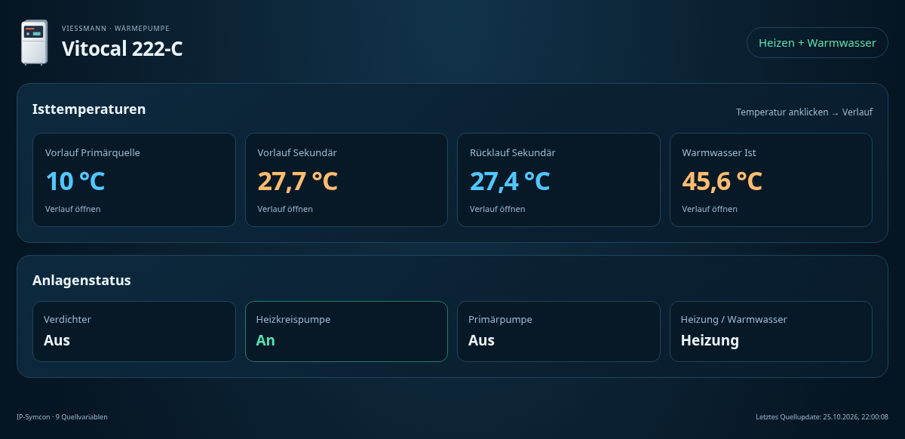
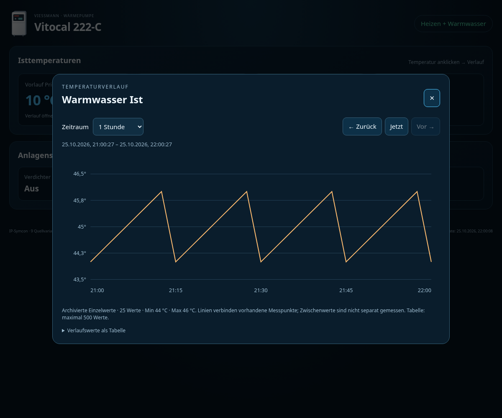

# Viessmann Vitocal 222-C · Kachel für IP-Symcon

Modul für die **Kachelvisualisierung ab IP-Symcon 7.1**. Zeigt vier gemessene Temperaturen, Pumpen, Verdichter, Umschaltventil und Betriebsart. Kompakte Anzeige der Istwerte und Anlagenzustände mit kleinem Wärmepumpensymbol und verkleinertem Gerätekopf, ohne Anlagenschema. **Keine Sollwertanzeigen oder Sollwerteingaben, keine Lüftungsdaten.** Die Betriebsart wird ausschließlich als aktueller Status angezeigt; die gesamte Kachel ist schreibgeschützt.



## Installation und Update

In **Module Control** das Repository `https://github.com/somm86/Viessmann-Vitocal-222` mit Branch `main` hinzufügen oder aktualisieren. Instanz **Vitocal 222-C Kachel** erstellen bzw. die vorhandene Instanz öffnen, **Übernehmen** drücken und die Kachel neu öffnen. Bibliotheks- und Modul-GUIDs bleiben beim Update gleich; keine neue Instanz erforderlich.

Alternativ das mit `python3 tests/build.py` erzeugte `Vitocal222C-Kachel-1.8.zip` entpacken und den enthaltenen Ordner `Vitocal222C_Kachel` vollständig nach `<Symcon-Datenverzeichnis>/modules/` auf dem Symcon-Server kopieren. Direkt darin muss `library.json` liegen. Symcon-Dienst neu starten. Nicht gleichzeitig per Module Control und lokal installieren.

Die Instanz zur Kachelvisualisierung hinzufügen bzw. verlinken. Die Darstellung passt sich der verfügbaren Kachelbreite und -höhe an. Bei geringer Höhe wird die komplette Übersicht proportional verkleinert, einschließlich Gerätesymbol und Fußzeile. Wird die Kachel wieder größer, kehrt sie bis zur ursprünglichen Darstellungsgröße zurück. Die Übersicht benötigt keine vertikale Bildlaufleiste; der Verlaufsdialog besitzt bei Bedarf einen eigenen Scrollbereich. Die Geräteintegration muss die vorhandenen Variablen aktualisieren; die Kachel verbindet sich nicht selbst mit der Wärmepumpe.

## Anpassung an die Kachelgröße

Ein `ResizeObserver` erkennt Änderungen der verfügbaren Fläche, auch beim Vergrößern oder Verkleinern der eingebetteten Symcon-Kachel. Die Übersicht wird unter Beibehaltung der Proportionen in Breite und Höhe eingepasst. Durch die entsprechend angepasste interne Layoutbreite bleibt die sichtbare Kachelbreite ausgenutzt. Live-Updates, längere Statusbeschriftungen und geladene Schriftarten lösen eine erneute Einpassung aus. Bei geringer Höhe werden zunächst Abstände und Innenränder kompakter, bevor die gesamte Ansicht verkleinert wird. In sehr flachen Kacheln wird auch der Text entsprechend kleiner.

Der Temperaturverlauf öffnet außerhalb der skalierten Übersicht als Dialog. Seine Bedienelemente verwenden die normale Schriftgröße; bei geringer Höhe lässt sich der Dialog intern scrollen. Geräteabbildung, Istwerte und Statusanzeigen bleiben schreibgeschützt.

## Vorbelegte Quellen

| Wert | ID | Eigenschaft |
|---|---:|---|
| Betriebsart Heizung | 53049 | `ModeID` |
| Heizkreispumpe | 20926 | `HeatingPumpID` |
| Primärpumpe | 39794 | `PrimaryPumpID` |
| Rücklauftemperatur Sekundär | 21875 | `ReturnID` |
| Ventil Heizen/Warmwasser | 53786 | `ValveID` |
| Verdichterbetrieb | 31722 | `CompressorID` |
| Vorlauftemperatur Primärquelle | 18104 | `PrimaryFlowID` |
| Vorlauftemperatur Sekundär | 18969 | `FlowID` |
| Warmwasser Ist | 56634 | `WaterID` |

Alle IDs sind in der Instanz änderbar. Die früheren Sollwertquellen `10939` und `27660` werden nicht mehr gelesen, angezeigt oder geschaltet. Eine Raum-Isttemperatur war nicht vorhanden und wird nicht aus dem Raumsollwert abgeleitet. Abluft, Fortluft, Lüftungsaußentemperatur, Lüftungsbetriebsart, Filterrestzeit und Zuluft-Volumenstrom sind ausgeschlossen.

Temperaturen müssen in °C vorliegen. Pumpen und Umschaltventil verwenden die formatierten Quellwerte; die Bedeutung des Ventilwerts wird nicht eigenmächtig umgedreht. Aktive Pumpen-/Verdichtersignale werden in den Statusfeldern grün hervorgehoben.

## Temperaturverlauf

Eine der vier Temperaturkarten anklicken oder per Tastatur aktivieren. Es öffnet sich ein Graph mit:

- **1 Stunde, 6 Stunden, 24 Stunden, 7 Tage oder 30 Tage** als Zeitbereich.
- **Zurück** und **Vor**: um einen vollständigen gewählten Zeitraum blättern.
- **Jetzt**: an die aktuelle Zeit springen und Daten neu laden; Navigation in die Zukunft ist gesperrt.
- Zeitpunkt und Temperatur am nächstgelegenen Messpunkt per Maus/Touch sowie einer aufklappbaren Tabelle mit maximal 500 Werten.

Die Zeiträume sind feste, rollende Dauern; 24 Stunden sind unabhängig von Sommerzeitwechseln 86.400 Sekunden. Datum und Uhrzeit verwenden die lokale Browser-Zeitzone. Die Zeitachse reicht immer über den ausgewählten Bereich, nicht nur zwischen den vorhandenen Messpunkten. Ein normaler Livewert-Refresh verschiebt ein geöffnetes historisches Fenster nicht. Zum Aktualisieren **Jetzt** drücken. Der Dialog lässt sich mit **✕** oder **Escape** schließen.



### Archivierung als Voraussetzung

Im Symcon **Archive Control** muss die Archivierung für `18104`, `18969`, `21875` und `56634` bzw. deine abweichenden Isttemperatur-IDs aktiv sein. Archivierung als **Standardwert**, nicht als Zähler konfigurieren. Die Kachel schaltet die Archivierung nicht selbst ein und verändert keine historischen Daten. Alte Werte werden durch Aktivierung nicht nachträglich erzeugt.

In der Instanz kann **Archive Control** ausgewählt werden. Mit `0` sucht die Kachel für die angeklickte Temperatur automatisch das erste Archiv mit aktiver Aufzeichnung. Bei mehreren Archiven eine explizite Instanz auswählen; eine ausdrücklich gewählte Instanz wird nicht stillschweigend ersetzt. Fehlende Archivierung beeinflusst den Graphen, die aktuellen Werte bleiben nutzbar.

Bis einschließlich 48 Stunden werden `AC_GetLoggedValues()`-Einzelwerte gelesen. Für 7 und 30 Tage werden über `AC_GetAggregatedValues(..., 0, ...)` Stundenmittelwerte verwendet und als solche beschriftet. Keine historischen Werte werden aus dem aktuellen Wert erfunden. Linien verbinden vorhandene Messpunkte; Zwischenwerte sind nicht separat gemessen. Fehlende Daten und Fehler erscheinen im Dialog. Wird das API-Limit von 10.000 Einträgen erreicht, wird der Graph nicht unbemerkt abgeschnitten: einen kleineren Zeitraum oder 7/30 Tage mit Stundenmitteln wählen.

Die Datenübertragung läuft über die HTML-SDK-Brücke und den Visualisierungsnachrichtenkanal. Jede Anfrage hat eine eigene Kennung; verspätete Antworten aus einem anderen Zeitraum, einer anderen Temperatur, einem anderen geöffneten Client oder einem geschlossenen Dialog werden verworfen. Nach 15 Sekunden ohne Antwort wird ein Hinweis angezeigt. Keine WebHooks, CDN-, npm- oder Chartbibliotheken erforderlich.

## Betriebsart: nur Status

Variable `53049` wird mit ihrem formatierten Quellwert oben in der Statusanzeige dargestellt. Es gibt keine Betriebsartauswahl und keine Schaltaktionen mehr. Eine Profil-Auswahlliste oder Variablenaktion ist für die Anzeige nicht erforderlich. Selbst direkte Aufrufe der ehemaligen Aktionen `ChangeMode`, `SetRoomTarget` und `SetWaterTarget` werden serverseitig abgewiesen. Die HTML-SDK-Aktion wird ausschließlich für lesende Archivabfragen verwendet.

Die Diagnose ist ausschließlich in der Instanz über **Quellen-Diagnose anzeigen** mit den konfigurierten Quell-IDs und dem Archiv verfügbar. In der Kachel wird keine Quellendiagnose eingeblendet. Die Fußzeile mit Quellenstatus und letztem Quellupdate verwendet 9 px Schriftgröße.

## Entwicklung und Prüfungen

Benötigt PHP mit `mbstring`, Python 3 und für den Browsertest Playwright/Chromium. Produktiv werden nur die PHP-/HTML-Dateien des Moduls benötigt, keine Testpakete oder Viessmann-Zugangsdaten.

```sh
git clone https://github.com/symcon/SymconStubs.git /tmp/SymconStubs
git -C /tmp/SymconStubs checkout 31f2e0478eb3763236fcf44ea4144271fdeddfd5
php -l Vitocal222CTile/module.php
SYMCON_STUBS=/tmp/SymconStubs php tests/module_test.php
python3 -m pip install playwright==1.62.0
python3 -m playwright install chromium
python3 tests/browser_test.py
# Alternativ: CHROMIUM_PATH=/usr/bin/chromium python3 tests/browser_test.py
python3 tests/build.py
```

Der Build legt ZIP und SHA-256-Datei standardmäßig **außerhalb** des Repositorys im benachbarten Ordner `Viessmann-Vitocal-222-artifacts/` ab. Ein anderes externes Ziel ist mit `python3 tests/build.py --output-dir /tmp/vitocal-artifacts` möglich. Ausgaben innerhalb des Repositorys werden abgewiesen: Symcon behandelt nicht reservierte Unterordner wie `dist` als Module und verlangt dort eine `module.json`. GitHub Actions stellt die Pakete als Build-Artefakt bereit; ZIP-Dateien werden nicht im Modul-Repository abgelegt.

Tests erzeugen ihre Fixtures unter `tests/output/` und aktualisieren die ausdrücklich synthetischen Vorschau-Screenshots. `tests/build.py` erstellt das ZIP und die SHA-256-Datei und prüft Manifeste, Identitäten, Dateiliste und ZIP-Integrität. [Prüfbericht und Grenzen](docs/VALIDATION.md).

Basiert auf der [Vitovent-300-F-Kachel](https://github.com/somm86/Viessmann-Vitovent-300F-Kachel-Symcon), Referenzcommit `75693d21426088d10e37771b681850b7c8e770f3`, mit eigenen GUIDs und eigenem Präfix. Keine offizielle Verbindung zu Viessmann oder Symcon. Die referenzierte Vorlage enthält keine Lizenzdatei; dieses Projekt erteilt keine zusätzliche Lizenz für übernommenen Code.
